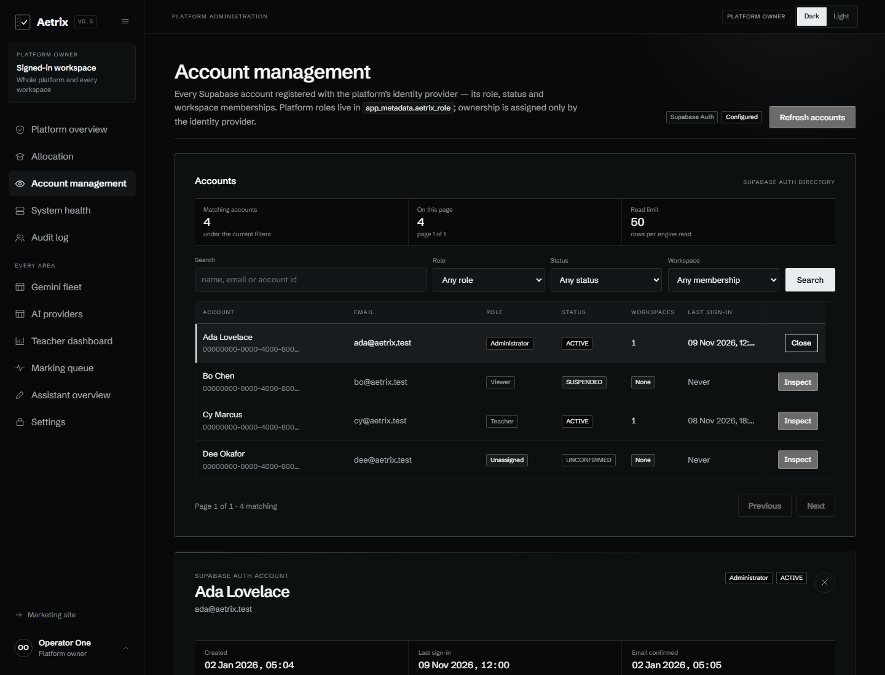

# Aetrix V5.5

**Aetrix is a pre-release, AI-assisted mathematics marking platform.** It combines a
FastAPI correction engine, a tenant-scoped React application, a frozen correction
benchmark and the product record in one repository.

<p>
  <a href="https://aetrix.pages.dev"></a>
  <a href="https://arthur-rip-zn02.tail06bb75.ts.net/health"></a>
  
  
  
  
</p>

> **Status: pre-release integration checkpoint.** The engine's tenancy, job lifecycle,
> marking pipeline, results and review APIs are covered by automated tests. The public
> frontend, role-aware application shell and account administration surfaces are deployed.
> **Live Gemini marking is `UNVERIFIED`**, no benchmark holdout paper is certified, and
> this repository does not claim production readiness or marking accuracy.

## Live

| Surface | URL | What is there |
|---|---|---|
| Frontend | <https://aetrix.pages.dev> | Cloudflare Pages build of the marketing site and authenticated application shell |
| Engine | <https://arthur-rip-zn02.tail06bb75.ts.net> | FastAPI demo engine published through a Tailscale Funnel; `/health` and `/ready` are public |
| API schema | <https://arthur-rip-zn02.tail06bb75.ts.net/docs> | Development-only OpenAPI documentation; disabled in a production posture |

The demo backend runs on the maintainer's workstation, not an always-on cloud service.
The Funnel is beta infrastructure and the instance can be offline when the machine is
off; a failed health check is reported honestly rather than replaced with sample data.
The application is invitation-gated. There is no public sign-up path and no public
platform-owner role.

## Product preview



*Account management, a shared surface for reading identity-provider accounts and editing
platform roles. The rows in this Playwright capture are synthetic (`@aetrix.test`), not
live account data.*

Aetrix ingests exam papers and mark schemes, turns a scheme into an approved, immutable
blueprint, and tracks each correction as a leased job. The correction pipeline parses
structured question marks and evidence, checks algebraic equivalence with SymPy, and
routes uncertainty to human review instead of inventing a zero. Results, reviewer
decisions, overrides and approvals are stored with audit records.

The product is not presented as finished. Screens without a real engine contract render
an explicit unavailable state; the UI never fills a gap with fake rows or placeholder
metrics.

## Architecture

```text
Browser
  │  HTTPS, Supabase session
  ▼
Cloudflare Pages ── TanStack Start + React 19 (static client)
  │  Bearer JWT
  ▼
FastAPI engine ───────────────────────────────┐
  │  SQLAlchemy 2.0 + Alembic                 │
  ▼                                           ▼
PostgreSQL / Supabase                    Gemini REST adapter
  │  tenant-scoped repositories             (live provider UNVERIFIED)
  │  RLS deny-all Data API
  ▼
Correction worker ── lease ──► pipeline ──► results / review / approval
  └── document ingestion, page mapping, local filesystem storage
```

The engine is the authority. A tenant is resolved from the verified JWT claim in
`backend/app/api/deps.py`, never from a request body; cross-tenant reads look
nonexistent. The API and worker are separate processes. PostgreSQL leases use
`FOR UPDATE SKIP LOCKED`, and audit, job-event and usage rows are append-only at the
database layer.

`docs/` preserves the original Cloudflare D1/Better Auth/R2/Queues blueprint as product
history. The implemented data layer is PostgreSQL/Supabase; ADR-001 records that conflict.
The benchmark is frozen and never imported by production code.

## What is in the repository

| Area | State | Notes |
|---|---|---|
| Authentication and invitations | Implemented | Supabase JWT/JWKS verification, invitation-only provisioning, role fallback, session and sign-out flows |
| Tenant isolation | Implemented and integration-tested | Workspace and object reads are scoped from the verified identity; foreign IDs return 404 |
| Exams, blueprints and schemes | Implemented | Drafting, approval, immutable versions and overrides |
| Assignments, submissions and documents | Implemented | Registration, PDF ingestion, validation, page mapping and local storage |
| Correction jobs and worker | Implemented | Idempotency, leases, attempts, cancellation, retry policy and typed failure states |
| Marking pipeline and results | Tested, live marking unverified | Strict structured output, SymPy verification, question results and evidence; provider reachability is not an accuracy claim |
| Human review and approval | Implemented and integration-tested | Reviewer decisions, reasoned overrides, approval gate and audit |
| Roster, classes and CSV import | Implemented | Tenant-owned roster with row-level import diagnostics |
| Workspace data surfaces | Implemented | Dashboard, assignments, submissions, queue, gradebook, inbox, reports and history |
| Account and provider administration | Implemented and browser-tested | Account directory, role management, provider fleet, model catalogue and quotas |
| Google Classroom | Partial | Course OAuth and discovery; roster import and grade publishing are not implemented |
| Object storage and scanning | Unavailable | Local filesystem adapter only; no malware scanner or object-storage backend |
| Rate limiting | Unavailable | No rate-limit middleware or headers |
| Benchmark certification | Unavailable | 207 frozen tests pass; the holdout has zero certified papers |

## Verification

These are the checks executed for this release. They are not a claim that every path
has been exercised against a live provider.

| Check | Command | Result |
|---|---|---|
| Engine lint | `cd backend && .venv/Scripts/python.exe -m ruff check app tests` | **pass** |
| Engine unit suite | `cd backend && .venv/Scripts/python.exe -m pytest tests/unit -q` | **237 passed** |
| Frontend typecheck | `cd frontend && ../.tools/node/node.exe node_modules/typescript/bin/tsc --noEmit` | **exit 0** |
| Production build | `cd frontend && ../.tools/node/node.exe node_modules/vite/bin/vite.js build` | **exit 0** |
| Account browser tests | Playwright `tests/accounts.spec.ts` against a production preview | **8 passed** |
| Full browser suite | Playwright against a production preview | **205 passed, 2 skipped** |
| Live engine probes | `GET /health`, `GET /ready` | **200, 200** |

The two skipped browser tests are live-engine DOM probes that require
`VITE_AETRIX_API_URL` in the test process; they are reported as skipped, not as passes.
The backend integration suite was **not rerun** for this gate because
`AETRIX_TEST_DATABASE_URL` was unset. That suite truncates its target database by design,
so it is never pointed at the shared development database. Earlier implementation work
records 128 integration tests passing against a disposable local PostgreSQL instance.

The account directory was inspected in the browser at 390 px and 900 px: the table
scrolls inside its surface, the sticky action column remains reachable, the detail panel
opens and closes without leaving the directory, and the empty, loading and error states
all stay inside the Accounts surface. The screenshot above was captured at 1440 px from
a Playwright fixture using synthetic rows.

## Quick start

### Backend

Python 3.12–3.13 and PostgreSQL 15+ are required. SQLite is refused.

```bash
cd backend
python -m venv .venv
.venv/Scripts/python.exe -m pip install -e ".[dev,benchmark]"   # Windows
# .venv/bin/python -m pip install -e ".[dev,benchmark]"          # macOS/Linux
cp .env.example .env
# Set AETRIX_DATABASE__URL, JWT/JWKS values and encryption secrets in .env.
.venv/Scripts/python.exe -m alembic upgrade head
.venv/Scripts/python.exe -m uvicorn app.main:app --host 127.0.0.1 --port 8000
```

Run the worker in a separate process with `.venv/Scripts/python.exe -m app.worker`.
When the provider is unavailable, the worker records a classified retryable failure
instead of writing fabricated marks.

### Frontend

Node.js 20+ is required.

```bash
cd frontend
npm ci
npm run typecheck
npm run build
npm run dev
```

Set `VITE_AETRIX_API_URL` to an HTTPS engine origin before building a deployed bundle.
It is compiled into the client and must not be a loopback address. `npm run test:e2e`
expects a running preview and Playwright browsers.

### One-command Windows stack

The repository includes lifecycle scripts for a loopback engine plus a stable HTTPS
tunnel. The filled `aetrix-stack.env` is git-ignored.

```bat
START_AETRIX.bat   :: backend + tunnel + public health, readiness, CORS and frontend checks
STATUS_AETRIX.bat  :: read-only status
STOP_AETRIX.bat    :: stops only recorded Aetrix processes
RESTART_AETRIX.bat :: reload the current backend code
```

The stack supports a Cloudflare named tunnel or Tailscale Funnel. The current demo uses
Tailscale Funnel because it does not require a Cloudflare-managed DNS zone. Never point
the Funnel at anything other than the loopback API, and disable `/docs` for a truly
public deployment.

### Benchmark

```bash
python -m pytest benchmark/tests benchmark/holdout/tests -q
python -m benchmark.holdout.manifest --check-code
```

The benchmark tests do not require a provider key. A benchmark result is not a marking
accuracy claim until the holdout contains independently certified papers.

## Security and data handling

- **No secrets in Git.** `backend/.env`, `frontend/.env`, `.dev.vars`, provider keys and
  tunnel credentials are ignored. Examples contain placeholders only.
- **Tenant scope comes from identity.** Repositories scope every tenant-owned lookup;
  the browser cannot select a tenant by request body.
- **Append-only history.** Audit events, job events and provider usage are protected by
  database triggers.
- **No fabricated data.** API failures, unavailable engine routes and unconfigured
  integrations produce explicit states. The marker never fills missing results with zeros.
- **Not hardened for untrusted production.** Rate limiting, malware scanning, backup and
  restore, external monitoring and a production object-storage adapter are still absent.

## Repository map

| Path | Contents |
|---|---|
| [`backend/`](backend/) | FastAPI engine, SQLAlchemy models, Alembic migrations, worker and pytest suites |
| [`frontend/`](frontend/) | TanStack Start/React application, Playwright tests and Cloudflare Pages configuration |
| [`benchmark/`](benchmark/) | Frozen A/B/C correction benchmark and holdout intake |
| [`docs/architecture/`](docs/architecture/) | System architecture, ADRs and the implemented-vs-historical boundary |
| [`docs/engine/`](docs/engine/) | Engine design, constraints and evidence |
| [`docs/audits/`](docs/audits/) | Dated acceptance reports; treat them as historical evidence, not a current release claim |
| [`scripts/`](scripts/) | Stack lifecycle, status and tunnel helpers |

## Limits

- **Live marking is unverified.** Provider reachability has been observed with registered
  keys, but no live marking result has been certified and the benchmark holdout has zero
  certified papers.
- **Google OAuth is not fully configured.** The Supabase Google provider must use the
  matching client before an interactive consent round trip can be called complete.
- **The demo backend is a workstation process.** It is not a 24/7 production service.
- **Storage is local.** The local filesystem adapter is not object storage and has no
  malware scanning or retention policy.
- **The public API runs in development mode.** `/docs` and OpenAPI are reachable on the
  demo Funnel; that is not an acceptable production configuration.
- **No accuracy claim.** The presence of a pipeline, tests and a benchmark is not evidence
  of marking parity with an examiner.

## History

The repository was formerly `WebPage_UI_V5.5`; the engine was developed separately in
[`Engine_V5.5`](https://github.com/AetherRIP/Engine_V5.5). The consolidated project is
**V5.5**. See [`docs/consolidation/CONSOLIDATION_REPORT.md`](docs/consolidation/CONSOLIDATION_REPORT.md)
for the consolidation record and preserved history.
