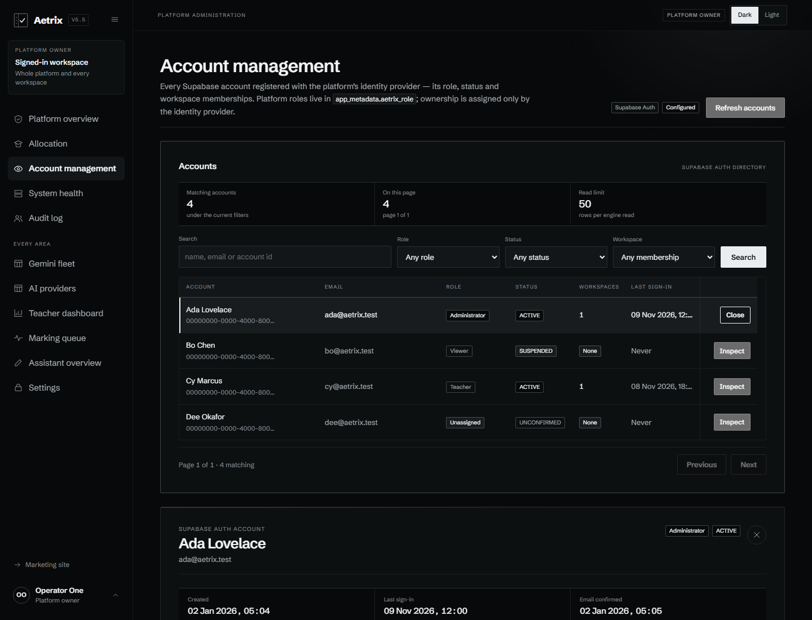

# Aetrix V5.5

**Aetrix is a pre-release, AI-assisted mathematics marking platform.** It combines a
FastAPI correction engine, a tenant-scoped React application, a frozen correction
benchmark and the product record in one repository.

<p>
  <a href="https://aetrix.pages.dev"></a>
  <a href="#engine-status"></a>
  <a href="https://github.com/AetherRIP/Aetrix_V5.5/actions/workflows/ci.yml"></a>
  
  
  
  
</p>

> **Production deployment:** <https://aetrix.pages.dev>, built from `main` by the
> Cloudflare Pages GitHub integration. **Last verified:** 2026-11-15 against Pages
> deployment `4717e76`; the frontend changes it serves are from `65a479d`. See the
> [production verification run](https://github.com/AetherRIP/Aetrix_V5.5/actions/runs/43725473948).

> **Status: pre-release integration checkpoint.** The engine's tenancy, job lifecycle,
> marking pipeline, results and review APIs are covered by automated tests. The public
> frontend, role-aware application shell and account administration surfaces are deployed.
> **Live Gemini marking is `UNVERIFIED`**, no benchmark holdout paper is certified, and
> this repository does not claim production readiness or marking accuracy.

## Live

| Surface | URL | What is there |
|---|---|---|
| Frontend | <https://aetrix.pages.dev> | Cloudflare Pages build of the marketing site and authenticated application shell |
| Engine (on demand) | — | FastAPI demo engine on the maintainer's workstation, previously exposed through a Tailscale Funnel. `arthur-rip-zn02.tail06bb75.ts.net` does not resolve as of 2026-11-15; see [Engine status](#engine-status). |
| API schema | — | Development-only OpenAPI documentation; unreachable while the demo hostname is offline |

The demo backend runs on the maintainer's workstation, not an always-on cloud service.
The Funnel is beta infrastructure and the instance can be offline when the machine is
off; a failed health check is reported honestly rather than replaced with sample data.
There is no public sign-up form and no public platform-owner role. Workspace access is
provisioned by the engine: by default only an invitation, or the one-time acceptance code
issued with it, creates a membership. A deployment may instead enable
`AETRIX_AUTH__OPEN_ACCESS=true` to admit any Google-verified account to one shared
workspace, which never widens tenancy — reads stay scoped to that workspace — and every
admission is audited.

### Engine status

**Offline as of 2026-11-15.** The demo hostname `arthur-rip-zn02.tail06bb75.ts.net`
currently fails DNS resolution, so its `/health` and `/ready` endpoints cannot be
reached. The Pages frontend remains available and renders explicit unavailable states
for engine-backed data; it does not substitute sample rows or zeros. Start the stack
with `START_AETRIX.bat` and check it with `STATUS_AETRIX.bat` before expecting marking,
queue or account data to load. A successful local start does not make the workstation a
24/7 production service.

## Product preview



*Account management, a shared surface for reading identity-provider accounts and editing
platform roles. The rows in this Playwright capture are synthetic (`@aetrix.test`), not
live account data.*

Aetrix ingests exam papers and mark schemes, turns a scheme into an approved, immutable
blueprint, and tracks each correction as a leased job. The correction pipeline parses
structured question marks and evidence, checks algebraic equivalence with SymPy, and
routes uncertainty to human review instead of inventing a zero. Results, reviewer
decisions, overrides and approvals are stored with audit records.

The product is not presented as finished. Screens without a real engine contract render
an explicit unavailable state; the UI never fills a gap with fake rows or placeholder
metrics.

## Marketing surface

The public pages share one drafting field: a masked grid, three static pools of light and
translucent panes that refract them. `backdrop-filter` is deliberately absent on this
surface — the blur was measured as the dominant scroll cost and removed.

### Scroll choreography

The landing page is five pinned acts and one pinned film frame, driven by GSAP
ScrollTrigger `pin` + `scrub`. An act fixes its stage at the top of the viewport,
transforms its scenes inside that frame, and releases when the timeline ends:

| Act | Section | Pin | What the scroll drives |
|---|---|---|---|
| I | opening (`#opening`) | 220% | hero copy and lattice lift out while the field stays, three paper sheets converge, question brackets and evidence chips resolve |
| II | transformation (`#transformation`) | 320% | the six stages of one correction, caption track collapsing to the active stage |
| III | scenes (`#chapters`) | 560% | six scenes hand over inside one frame, with a marker rail and a 01–06 counter |
| IV | instrument (`#instrument`) | 180% | the eight-layer stack assembles and explodes |
| V | transparency (`#security`) | 240% | the evidence trail walked node by node |
| — | platform film (`#platform`) | 110% | the frame assembles from a clip path and holds, then the page continues |

The pinned layout is progressive enhancement, not the page itself. It is enabled by
`data-cinema="on"`, which `frontend/src/components/marketing/motion.ts` sets only after
GSAP has loaded and only at ≥900px. Below that width, under
`prefers-reduced-motion: reduce`, or with no JavaScript, the same markup is an ordinary
stacked document — every scene readable, nothing pinned, nothing hidden.

Scenes that are not on stage are hidden with `visibility` (GSAP `autoAlpha`), never
opacity alone, so an invisible scene cannot swallow a click or hold a tab stop. That was
a real defect: the incoming opening scene sat over the hero's buttons and made them
unclickable.

### What the motion costs

- The ambient shader draws at 0.68 of its CSS size, at 30fps, and creates its WebGL
  context only when the canvas comes within 250px of the viewport.
- The hero glow is a static gradient with one transform drift: no blur filter and no
  blend mode sits on any animated layer.
- The 3D instrument imports three only when the section approaches, and renders only
  while something is moving — at rest the loop stops and costs no frames.
- Measured over a 3-second idle window at 1440×900 in software-rendered Chromium, before
  and after that work: idle frame throughput at the top of the page 8.9 → 52.8 fps and
  long tasks 37 (4.1 s) → 3 (0.37 s); inside the instrument act 1.8 → 60.3 fps and
  29 (14.1 s) → 9 (0.88 s). WebGL contexts alive at load: 3 → 1.

### Without WebGL2

The instrument needs WebGL2, which Chromium also provides in software when hardware
acceleration is off. Where no WebGL2 context exists at all, or the GPU context is lost
mid-session, the section switches to a flat SVG diagram of the same eight layers that
still assembles with the scroll and isolates a layer on selection, and the hint says so.
The capability probe runs before three is constructed and the reason is logged to the
console.

The sign-in page is a clearance desk: a masthead carrying the real access policy, the
access-status ledger, and a handshake band that names the four steps the OAuth exchange
actually performs — PKCE challenge in the browser, Google consent, the single-use code
exchanged at `/auth/callback`, and token verification in the engine. It describes the
code; it does not mock it up.

One decorative element follows the pointer: a 480 px lamp moved by `transform` alone and
written by a single `requestAnimationFrame` loop that stops once it has caught up. It is
`aria-hidden`, never receives a pointer event, is not installed for coarse pointers, and
is removed from the layout under `prefers-reduced-motion`. Removing the layer entirely
left median and p95 scroll frame times unchanged in a paired measurement, so the follow
curve is tuned for feel rather than for a frame-time budget.

## Architecture

```text
Browser
  │  HTTPS, Supabase session
  ▼
Cloudflare Pages ── TanStack Start + React 19 (static client)
  │  Bearer JWT
  ▼
FastAPI engine ───────────────────────────────┐
  │  SQLAlchemy 2.0 + Alembic                 │
  ▼                                           ▼
PostgreSQL / Supabase                    Gemini REST adapter
  │  tenant-scoped repositories             (live provider UNVERIFIED)
  │  RLS deny-all Data API
  ▼
Correction worker ── lease ──► pipeline ──► results / review / approval
  └── document ingestion, page mapping, local filesystem storage
```

The engine is the authority. A tenant is resolved from the verified JWT claim in
`backend/app/api/deps.py`, never from a request body; cross-tenant reads look
nonexistent. The API and worker are separate processes. PostgreSQL leases use
`FOR UPDATE SKIP LOCKED`, and audit, job-event and usage rows are append-only at the
database layer.

`docs/` preserves the original Cloudflare D1/Better Auth/R2/Queues blueprint as product
history. The implemented data layer is PostgreSQL/Supabase; ADR-001 records that conflict.
The benchmark is frozen and never imported by production code.

## What is in the repository

| Area | State | Notes |
|---|---|---|
| Authentication and invitations | Implemented | Supabase JWT/JWKS verification, invitation-first provisioning with an optional shared-workspace open-access mode (`AETRIX_AUTH__OPEN_ACCESS`), role fallback, session and sign-out flows |
| Tenant isolation | Implemented and integration-tested | Workspace and object reads are scoped from the verified identity; foreign IDs return 404 |
| Exams, blueprints and schemes | Implemented | Drafting, approval, immutable versions and overrides |
| Assignments, submissions and documents | Implemented | Registration, PDF ingestion, validation, page mapping and local storage |
| Reviewer manual upload | Implemented and tested | A reviewer may register a script and upload a script or a mark scheme so marking continues while Google Classroom is unavailable; creating an exam, creating an assignment and approving a scheme stay with a teacher or administrator (`Principal.can_upload_documents`) |
| Correction jobs and worker | Implemented | Idempotency, leases, attempts, cancellation, retry policy and typed failure states |
| Marking pipeline and results | Tested, live marking unverified | Strict structured output, SymPy verification, question results and evidence; provider reachability is not an accuracy claim |
| Human review and approval | Implemented and integration-tested | Reviewer decisions, reasoned overrides, approval gate and audit |
| Roster, classes and CSV import | Implemented | Tenant-owned roster with row-level import diagnostics |
| Workspace data surfaces | Implemented | Dashboard, assignments, submissions, queue, gradebook, inbox, reports and history |
| Account and provider administration | Implemented and browser-tested | Account directory, role management, provider fleet, model catalogue and quotas |
| Google Classroom | Partial | Course OAuth and discovery; roster import and grade publishing are not implemented |
| Object storage and scanning | Unavailable | Local filesystem adapter only; no malware scanner or object-storage backend |
| Rate limiting | Unavailable | No rate-limit middleware or headers |
| Benchmark certification | Unavailable | 207 frozen tests pass; the holdout has zero certified papers |

## Verification

These are the checks executed for this release. They are not a claim that every path
has been exercised against a live provider.

| Check | Command | Result |
|---|---|---|
| Engine lint | `cd backend && .venv/Scripts/python.exe -m ruff check app tests migrations` | **pass** |
| Engine unit suite | `cd backend && .venv/Scripts/python.exe -m pytest tests/unit -q` | **355 passed** |
| Reviewer upload permissions | `pytest tests/unit/test_upload_permissions.py`; live probe as a REVIEWER against the demo engine | **9 passed**; register 201, document upload 201 `PROCESSED`, create exam / approve scheme / create assignment all 403 |
| Engine CI | GitHub Actions: full pytest against a disposable PostgreSQL service | **passed** |
| Schema and RLS | Live `alembic check`; `pg_class` scan | **head 0022; no drift; 44/44 public tables RLS** |
| Frontend typecheck | `cd frontend && ../.tools/node/node.exe node_modules/typescript/bin/tsc --noEmit` | **exit 0** |
| Production build | `cd frontend && npm run build` (client, SSR, dev-var strip and legal clean URLs) | **exit 0** |
| Full browser suite | Playwright against a production preview, including legal acceptance and whole-route layout coverage | **282 passed, 2 skipped (284 tests)** |
| Marketing scroll suite | `cd frontend && ../.tools/node/node.exe node_modules/@playwright/test/cli.js test tests/marketing.spec.ts` | **20 passed** |
| Responsive layout suite | `… test tests/responsive.spec.ts` (360–1920 px) | **91 passed** |
| Instrument in a GPU browser | Visible Chromium, `ANGLE (NVIDIA GTX 1050, Direct3D11)` | 3D at 811×605; stage stays at `top: 0`/`position: fixed` at four scroll offsets inside the pin; drag rotates; layer click sets the readout to `L4 · Implemented` |
| Production legal routes | `curl` all nine public legal URLs on <https://aetrix.pages.dev> | **9/9 returned 200** |
| Production smoke check | Cloudflare Pages check `4717e76`; verification workflow home title and routes | **passed** |
| Live engine probes | `GET /health`, `GET /ready` | **offline — DNS unresolved** |

The full merged suite ran 284 tests: 282 passed and 2 were skipped in 3m36s. The two
skipped browser tests are live-engine DOM probes that require `VITE_AETRIX_API_URL` in
the test process; they are reported as skipped, not as passes.
The local backend integration suite was not run for this gate because
`AETRIX_TEST_DATABASE_URL` was unset. That suite truncates its target database by design,
so it is never pointed at the shared development database. The GitHub CI job runs the
full backend suite against a disposable PostgreSQL service, and it passed.

The account directory was inspected in the browser at 390 px and 900 px: the table
scrolls inside its surface, the sticky action column remains reachable, the detail panel
opens and closes without leaving the directory, and the empty, loading and error states
all stay inside the Accounts surface. The screenshot above was captured at 1440 px from
a Playwright fixture using synthetic rows.

## Deployment

Production is the existing Cloudflare Pages project **`aetrix`**, at
<https://aetrix.pages.dev>. It is a static TanStack Start client, not a Workers upload
and not a Freebuff Sites deployment. The canonical path is:

```text
push to main → Cloudflare Pages GitHub integration → npm ci && npm run build → dist/client
```

- **Pages project:** `aetrix`, production branch `main`, source `AetherRIP/Aetrix_V5.5`.
- **Build root:** `frontend`; **build command:** `npm ci && npm run build`; **output:** `dist/client`.
- **Public build variables (set in Pages, values never committed):** `VITE_SUPABASE_URL`,
  `VITE_SUPABASE_ANON_KEY`, `VITE_AETRIX_API_URL`.
- **Verification:** [`.github/workflows/verify-production.yml`](.github/workflows/verify-production.yml)
  waits for the Cloudflare Pages check run for the pushed commit, then checks the home
  page and all legal routes. It does not deploy and needs no Cloudflare API credential
  of its own, so it cannot race the GitHub integration.
- **Runbook:** [`docs/deployment/PRODUCTION.md`](docs/deployment/PRODUCTION.md).
- **Pages dashboard:** <https://dash.cloudflare.com/?to=/:account/pages/view/aetrix>.

Routine releases must go through `main`. `npm run deploy:manual` is an emergency
fallback only: it builds and uses `wrangler pages deploy` against the same project. It
requires Cloudflare credentials in the local environment and must not be used to bypass
a failed verification. `wrangler deploy` (Workers) is not the deployment path for this
frontend.

To roll back, first revert the offending commit on `main` and let Pages rebuild; if the
integration is unavailable, use the Pages dashboard to roll back to the last known-good
deployment and still land a Git revert so the next push does not reintroduce it. No
custom domain is attached; `aetrix.pages.dev` is the production origin.

## Quick start

### Backend

Python 3.12–3.13 and PostgreSQL 15+ are required. SQLite is refused.

```bash
cd backend
python -m venv .venv
.venv/Scripts/python.exe -m pip install -e ".[dev,benchmark]"   # Windows
# .venv/bin/python -m pip install -e ".[dev,benchmark]"          # macOS/Linux
cp .env.example .env
# Set AETRIX_DATABASE__URL, JWT/JWKS values and encryption secrets in .env.
.venv/Scripts/python.exe -m alembic upgrade head
.venv/Scripts/python.exe -m uvicorn app.main:app --host 127.0.0.1 --port 8000
```

Run the worker in a separate process with `.venv/Scripts/python.exe -m app.worker`.
When the provider is unavailable, the worker records a classified retryable failure
instead of writing fabricated marks.

### Frontend

Node.js 20+ is required.

```bash
cd frontend
npm ci
npm run typecheck
npm run build
npm run dev
```

Set `VITE_AETRIX_API_URL` to an HTTPS engine origin before building a deployed bundle.
It is compiled into the client and must not be a loopback address. `npm run test:e2e`
expects a running preview and Playwright browsers. Production builds are created by
Cloudflare Pages on every push to `main`; see [Deployment](#deployment).

### One-command Windows stack

The repository includes lifecycle scripts for a loopback engine plus a stable HTTPS
tunnel. The filled `aetrix-stack.env` is git-ignored.

```bat
START_AETRIX.bat   :: backend + tunnel + public health, readiness, CORS and frontend checks
STATUS_AETRIX.bat  :: read-only status
STOP_AETRIX.bat    :: stops only recorded Aetrix processes
RESTART_AETRIX.bat :: reload the current backend code
```

The stack supports a Cloudflare named tunnel or Tailscale Funnel. The current demo uses
Tailscale Funnel because it does not require a Cloudflare-managed DNS zone. Never point
the Funnel at anything other than the loopback API, and disable `/docs` for a truly
public deployment.

### Benchmark

```bash
python -m pytest benchmark/tests benchmark/holdout/tests -q
python -m benchmark.holdout.manifest --check-code
```

The benchmark tests do not require a provider key. A benchmark result is not a marking
accuracy claim until the holdout contains independently certified papers.

## Security and data handling

- **No secrets in Git.** `backend/.env`, `frontend/.env`, `.dev.vars`, provider keys and
  tunnel credentials are ignored. Examples contain placeholders only.
- **Tenant scope comes from identity.** Repositories scope every tenant-owned lookup;
  the browser cannot select a tenant by request body.
- **Append-only history.** Audit events, job events and provider usage are protected by
  database triggers.
- **Uploading is not exam authority.** `ensure_uploader` admits a teacher, an
  administrator or a reviewer to ingestion; `ensure_exam_manager` still gates exam,
  assignment, scheme-approval and blueprint writes.
- **No fabricated data.** API failures, unavailable engine routes and unconfigured
  integrations produce explicit states. The marker never fills missing results with zeros.
- **Not hardened for untrusted production.** Rate limiting, malware scanning, backup and
  restore, external monitoring and a production object-storage adapter are still absent.

## Repository map

| Path | Contents |
|---|---|
| [`backend/`](backend/) | FastAPI engine, SQLAlchemy models, Alembic migrations, worker and pytest suites |
| [`frontend/`](frontend/) | TanStack Start/React application, Playwright tests and Cloudflare Pages configuration |
| [`benchmark/`](benchmark/) | Frozen A/B/C correction benchmark and holdout intake |
| [`docs/architecture/`](docs/architecture/) | System architecture, ADRs and the implemented-vs-historical boundary |
| [`docs/engine/`](docs/engine/) | Engine design, constraints and evidence |
| [`docs/audits/`](docs/audits/) | Dated acceptance reports; treat them as historical evidence, not a current release claim |
| [`scripts/`](scripts/) | Stack lifecycle, status and tunnel helpers |

## Limits

- **Live marking is unverified.** Provider reachability has been observed with registered
  keys, but no live marking result has been certified and the benchmark holdout has zero
  certified papers.
- **Google OAuth is not fully configured.** The Supabase Google provider must use the
  matching client before an interactive consent round trip can be called complete.
- **The demo backend is a workstation process.** It is not a 24/7 production service.
- **Storage is local.** The local filesystem adapter is not object storage and has no
  malware scanning or retention policy.
- **The public API runs in development mode.** `/docs` and OpenAPI are reachable on the
  demo Funnel; that is not an acceptable production configuration.
- **No accuracy claim.** The presence of a pipeline, tests and a benchmark is not evidence
  of marking parity with an examiner.

## History

The repository was formerly `WebPage_UI_V5.5`; the engine was developed separately in
[`Engine_V5.5`](https://github.com/AetherRIP/Engine_V5.5). The consolidated project is
**V5.5**. See [`docs/consolidation/CONSOLIDATION_REPORT.md`](docs/consolidation/CONSOLIDATION_REPORT.md)
for the consolidation record and preserved history.
