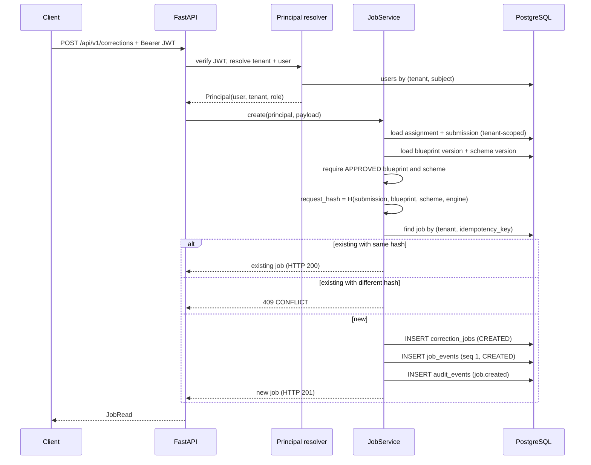
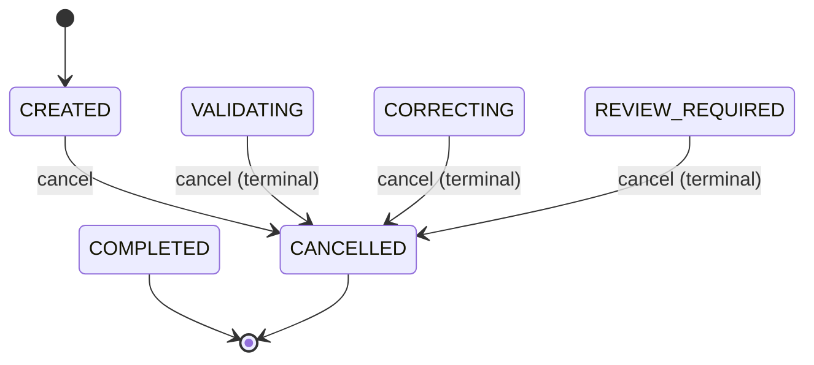
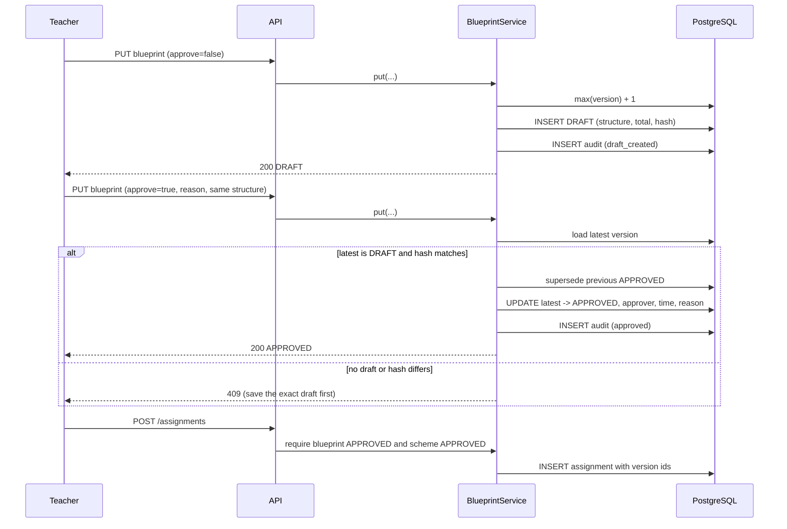
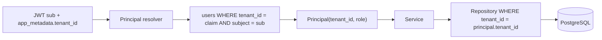
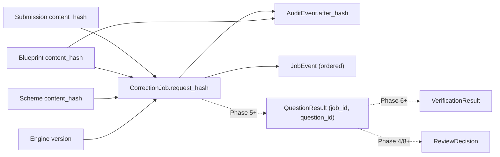
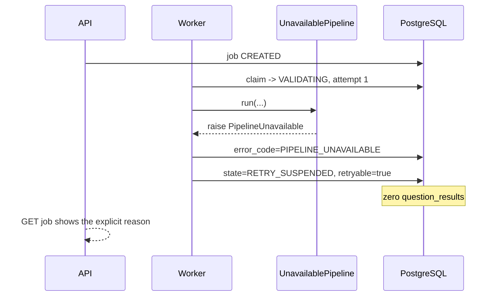
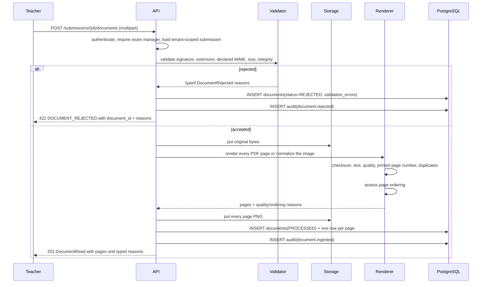
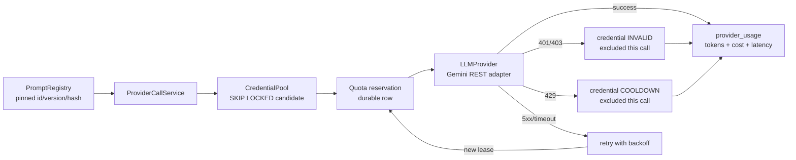
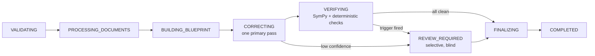

# Data Flow — Aetrix V5.5 (Checkpoints 1-2)

All diagrams describe **implemented** behavior unless explicitly marked
"planned". CP1 job creation, leasing and parking remain implemented; the
correction pipeline is still unavailable by design. CP2 adds ingestion, page
mapping, draft extraction and versioned overrides around the same approval gate.

---

## 1. Create a correction



The tenant is never taken from the request body. The assignment and submission
must both belong to the resolved tenant and to each other.

---

## 2. Worker claim and heartbeat

```mermaid
sequenceDiagram
    participant W as Worker
    participant R as JobRepository
    participant D as PostgreSQL
    participant H as Heartbeat thread
    participant P as Pipeline

    W->>R: claim_next(worker_id, lease_seconds)
    R->>D: SELECT ... FOR UPDATE SKIP LOCKED LIMIT 1
    alt no runnable job
        R-->>W: None (sleep, poll again)
    else runnable
        R->>D: attempts += 1, lease_owner, lease_expires_at
        R->>D: INSERT job_events (lease acquired)
        R->>D: COMMIT
        R-->>W: job
        W->>H: start (every heartbeat_seconds)
        H->>D: UPDATE lease_expires_at WHERE lease_owner = worker
        W->>P: run(job, session, settings)
        alt pipeline succeeds
            P-->>W: PipelineOutcome(final state)
            W->>D: transition(s) + clear lease + COMMIT
        else PipelineUnavailable
            W->>D: RETRY_SUSPENDED + PIPELINE_UNAVAILABLE
        else unexpected error
            W->>D: RETRY_SUSPENDED or FAILED by attempt budget
        end
        W->>H: stop; clear lease if still owned
    end
```

The heartbeat uses a separate session and commits independently. A slow pipeline
therefore cannot hold a transaction open, and a dead process stops renewing the
lease.

---

## 3. Crash and reclaim

```mermaid
sequenceDiagram
    participant W1 as Worker 1
    participant D as PostgreSQL
    participant W2 as Worker 2

    W1->>D: claim (attempt 1), lease expires T+60s
    W1--xW1: process killed
    Note over D: lease expires; no heartbeat
    W2->>D: claim_next()
    D-->>W2: same job (attempt 2), new lease
    alt pipeline succeeds on retry
        W2->>D: FINALIZING -> COMPLETED
    else attempt budget exhausted
        W2->>D: FAILED (LEASE_EXPIRED / MAX_ATTEMPTS_EXHAUSTED)
    end
```

A reclaim is a new attempt, not a silent duplicate. If the previous attempt had
written partial results, the future pipeline must make them idempotent by
`(job_id, question_id)` and must check `cancel_requested` before finalizing.
Phase 1 writes no results, so this test is about the lease, not partial marking.

---

## 4. Cancellation



`POST /cancel` is idempotent for an already-cancelled job. It:
1. locks the job row;
2. rejects a completed or failed job;
3. sets `cancel_requested`, clears the lease and transitions to `CANCELLED`;
4. writes an audit event.

The state is terminal, so the job cannot be reclaimed. A worker already inside
the pipeline may finish its current provider call, but it must observe the flag
before persisting results. Phase 5 implements those checkpoints.

---

## 5. Retry

`POST /retry` is allowed only from `FAILED` or `RETRY_SUSPENDED`. It:
1. locks the job;
2. resets `attempts` to 0, clears the error and the lease;
3. transitions to `VALIDATING`;
4. writes `job.retried` to the audit trail.

It does not change the blueprint or scheme version. Retrying preserves the
immutable contract the first attempt used.

---

## 6. Blueprint draft and approval



A draft is content-hashed. Approval cannot promote content that was not stored as
the current draft. Approving a new version supersedes the previous approved
version, but the old row remains readable.

---

## 7. Tenant isolation



If the token has no tenant claim, the resolver looks up the subject. If the
subject matches more than one workspace, the request is rejected as ambiguous.
A user who exists only in another tenant gets 403; a row in another tenant gets
404. The difference avoids leaking whether an id exists.

---

## 8. Provenance chain



Every job can be traced to the exact submission, blueprint, scheme and engine
version that produced it. Later phases append results and verification; they do
not rewrite the job.

---

## 9. Phase 1 parking (implemented)



This is the honest state of the build. A job is not marked, and the absence of
results is visible. A manual retry is required after Phase 5 supplies a real
pipeline.

---

## 10. Document ingestion (implemented)



No page is dropped. A blank, rotated, low-resolution or duplicate-looking page
keeps its row and carries a reason. If no printed page number is found, the
document is `UNVERIFIED`; if numbers are missing or out of sequence it is
`ORDER_SUSPECT`.

---

## 11. Page-to-question mapping (implemented)

```mermaid
sequenceDiagram
    participant T as Teacher
    participant A as API
    participant M as Mapper
    participant D as PostgreSQL
    participant S as Storage
    participant P as ProviderCallService

    T->>A: POST /documents/{id}/mapping (blueprint_version_id)
    A->>A: require exam manager
    A->>M: map(tenant, document, blueprint)
    M->>D: load document + pages (tenant-scoped)
    M->>D: load blueprint; require same exam and APPROVED
    loop each page
        M->>M: deterministic text-label match
        alt label found
            M->>M: record TEXT_MATCH identifiers
        else no label and provider available
            M->>S: read page PNG
            M->>P: prompt page_question_mapping@v1 + image
            P->>D: credential lease, quota reservation, usage row
            P-->>M: validated response or typed provider error
            M->>M: intersect identifiers with approved set
        end
        alt no identifiers
            M->>M: add NO_QUESTION_MATCH reason
        end
    end
    M->>D: replace mappings for document/version
    M->>D: set document MAPPED / PARTIAL / UNVERIFIED
    M->>D: INSERT audit(document.questions_mapped)
    M-->>T: status + reasons + mappings
```

Text matching is deterministic and preferred. The model is a fallback for pages
without a usable label; it cannot introduce an identifier outside the approved
blueprint. A model/provider failure leaves a visible mapping reason rather than
an empty success.

---

## 12. Scheme upload and draft extraction (implemented)

```mermaid
sequenceDiagram
    participant T as Teacher
    participant A as API
    participant S as SchemeService
    participant E as ExtractionService
    participant P as ProviderCallService
    participant B as BlueprintService
    participant D as PostgreSQL

    T->>A: POST /exams/{id}/schemes (PDF/image)
    A->>S: ingest as MARK_SCHEME
    S->>D: document PROCESSED, scheme + DRAFT version
    T->>A: POST /schemes/{version}/approve
    A->>S: require exam manager; approve version
    S->>D: status APPROVED + audit

    T->>A: POST /exams/{id}/blueprint/extractions
    A->>E: extract(scheme_version)
    E->>E: require exam manager before provider spend
    E->>D: load scheme version/document; reject wrong exam/superseded
    E->>P: blueprint_extraction@v1 + page images/text<br/>responseMimeType=application/json + responseJsonSchema
    P->>D: quota reservation, prompt version, usage row
    P-->>E: response text + usage/provenance
    E->>E: parse JSON (whole string, then balanced object in prose/fence)<br/>+ validate canonical BlueprintStructure
    alt invalid
        E-->>T: EXTRACTION_INVALID, no blueprint created
    else valid
        E->>B: create_extracted_draft(...)
        B->>D: INSERT blueprint version DRAFT (source=EXTRACTED)
        B->>D: INSERT audit(blueprint.draft_created)
        E-->>T: DRAFT + prompt/usage metadata
    end

    T->>A: PUT /exams/{id}/blueprint (approve=true, same hash)
    A->>B: existing hash-checked approval gate
    B->>D: supersede old APPROVED; promote exact DRAFT
```

Extraction has no approval branch. Even a perfect model response is only a
draft; the teacher must review and use the canonical approval endpoint. The
adapter requests JSON with `responseMimeType` and `responseJsonSchema`, skips
`thought: true` parts, and uses `parse_json_text` to accept a clean object, a
fenced object or an object embedded in prose. The parser does not repair
malformed JSON; malformed text remains `EXTRACTION_INVALID`.

---

## 13. Teacher override (implemented)

```mermaid
sequenceDiagram
    participant T as Teacher
    participant A as API
    participant O as OverrideService
    participant D as PostgreSQL

    T->>A: POST /exams/{id}/blueprint/overrides
    A->>O: create(base_version_id, rationale, operations)
    O->>O: require exam manager
    O->>D: load base (tenant + exam scoped); reject SUPERSEDED
    O->>O: apply typed operations, recompute total, validate structure
    O->>D: INSERT new blueprint version DRAFT (source=OVERRIDE)
    O->>D: INSERT blueprint_overrides (author, rationale, patch)
    O->>D: INSERT audit(blueprint.override_created)
    O-->>T: 201 base_version + result_version (DRAFT)
```

The base stays byte-for-byte readable. If the base is `APPROVED`, the database
trigger rejects any later attempt to mutate its structure or return its status to
`DRAFT`. Approval of the override uses the same exact-draft gate as any other
blueprint version.

---

## 14. Provider call path (implemented)



Every attempt writes a usage row. A key is never in the URL, log line, API
response or usage row; only its fingerprint is stored. A failed call is not a
silent success.

---

## 15. Planned marking flow (not implemented)



This diagram is a roadmap, not a claim. The Phase 1 state machine supports these
states and transitions; the work that fills them is Phases 2-8.
