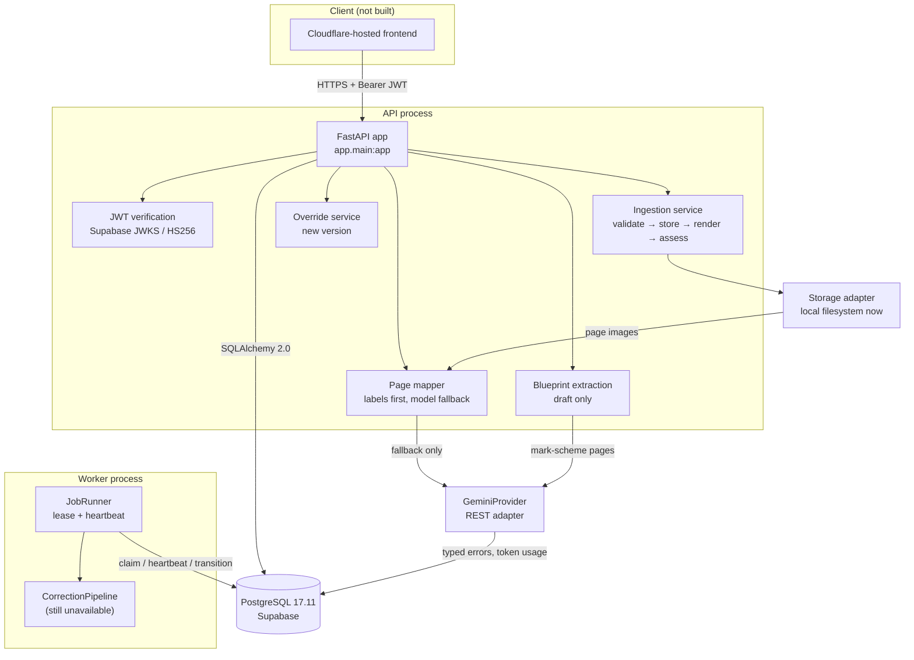

# System Overview — Aetrix V5.5 (Checkpoints 1-2)

## 1. Purpose and scope

Checkpoint 1 built the tenant, persistence, job, audit and approval substrate.
Checkpoint 2 adds the first real processing path around that substrate:

- a provider-independent model boundary with a live Gemini adapter;
- versioned prompt assets and auditable provider usage/quota;
- validated document ingestion, page rendering and page quality/ordering;
- page-to-question mapping against an approved blueprint;
- mark-scheme → draft blueprint extraction;
- versioned teacher overrides that cannot mutate an approved blueprint.

It still does **not** implement marking, verification, selective review, results,
cohort intelligence or a frontend. The correction worker's pipeline remains
explicitly unavailable and parks jobs with `PIPELINE_UNAVAILABLE`. No mark is
invented anywhere in this build.

**Non-claims:** not production-ready; no marking-accuracy claim; no live
structured-output or extraction claim (the bounded post-change probe was rejected
at authentication); no frontend; the holdout still has zero certified papers.

---

## 2. Runtime topology



The API and worker are separate processes sharing PostgreSQL. Extraction and
mapping are synchronous in this checkpoint; the worker does not run them. Marking
is still tied to the worker, not to an HTTP request.

---

## 3. Module map

| Path | Responsibility |
|---|---|
| `backend/app/core/config.py` | Typed settings, environment validation, provider/ingestion/quota settings |
| `backend/app/core/logging.py` | JSON logging, request/tenant/job context, redaction |
| `backend/app/core/errors.py` | Closed error vocabulary and safe handlers |
| `backend/app/core/security.py` | JWT verification, principal, Fernet secret box, role gates |
| `backend/app/db/models.py` | CP1 + CP2 domain tables |
| `backend/app/db/repositories.py` | Tenant-scoped reads/writes, leases, mappings, overrides, quota, usage |
| `backend/app/storage/` | Storage protocol and local filesystem adapter |
| `backend/app/documents/validation.py` | Signature/type/size/integrity validation |
| `backend/app/documents/rendering.py` | PDF/image rendering, checksums, duplicate detection |
| `backend/app/documents/quality.py` | Deterministic quality states and typed reasons |
| `backend/app/documents/ordering.py` | Printed-page-number ordering assessment |
| `backend/app/documents/service.py` | Non-destructive ingestion and page persistence |
| `backend/app/documents/mapping.py` | Text-first page→question mapping with model fallback |
| `backend/app/documents/blueprint_extraction.py` | Mark-scheme extraction into a draft |
| `backend/app/providers/base.py` | Provider-neutral protocol and dataclasses |
| `backend/app/providers/gemini.py` | The only Gemini wire-format module; requests JSON and skips thought parts |
| `backend/app/providers/json.py` | Tolerant JSON extraction from clean, prose-prefixed or fenced output |
| `backend/app/providers/factory.py` | Live/unavailable provider selection |
| `backend/app/services/provider_calls.py` | Prompt, credential, quota, retry, usage and cost path |
| `backend/app/services/schemes.py` | Scheme upload and approval |
| `backend/app/services/blueprint_overrides.py` | Typed override operations → new draft version |
| `backend/app/prompts/registry.py` | Content-addressed, version-pinned prompt assets |
| `backend/app/api/v1/documents.py` | Ingestion, mapping, scheme, extraction, override routes |
| `backend/app/api/v1/exams.py` | Exam and canonical blueprint draft/approval routes |
| `backend/app/jobs/` | CP1 job state machine, runner and unavailable pipeline |
| `backend/migrations/` | Alembic history through `0002_blueprint_guard_fix` |
| `backend/tests/` | Unit, PostgreSQL integration and API tests (84 passing) |
| `backend/scripts/live_extraction.py` | One-request manual extraction probe; writes a draft only on success |

---

## 4. Data model at a glance

The schema separates four kinds of truth:

1. **What the paper is** — `exams`, `exam_blueprint_versions`.
2. **What the scheme says** — `mark_schemes`, `mark_scheme_versions`,
   `marking_criteria`.
3. **What the examiner has processed** — `documents`, `document_pages`,
   `page_question_mappings`, `provider_usage`, `provider_quota_reservations`.
4. **What must remain provable** — `audit_events`, `provider_usage`,
   `prompt_versions`, `model_versions`, `blueprint_overrides`.

Key CP2 invariants:

- Every document, page and mapping is tenant-scoped.
- A document records its exam, optional submission, source filename, SHA-256,
  MIME type, size, status, quality/ordering/mapping status and typed reasons.
- A rejected upload is a persisted `REJECTED` document with `validation_errors`;
  it is not a vanished request.
- A page has a storage key, dimensions, quality status/reasons, ordering
  reasons, printed page number, checksum and optional duplicate link.
- Mapping rows reference the exact approved blueprint version and the page's
  canonical question id.
- A blueprint version is unique per `(exam_id, version)`; only one is `APPROVED`.
- Approved and superseded blueprint rows reject structural mutation and status
  regression at the database trigger.
- Extraction creates `DRAFT` only. Overrides create a new `DRAFT` version and a
  `blueprint_overrides` row carrying author, rationale and patch.
- `provider_usage` is append-only and records prompt version, model, purpose,
  tokens, cost (or NULL when unknown), latency, status and safe error class.
- Quota reservations are durable rows; an expired `RESERVED` row stops counting,
  while a consumed/failed call remains in the ledger.

---

## 5. Correction-job lifecycle

Unchanged from CP1. Thirteen states with guarded transitions:

```text
CREATED
  -> VALIDATING
  -> PROCESSING_DOCUMENTS
  -> BUILDING_BLUEPRINT
  -> CORRECTING
  -> VERIFYING
  -> COHORT_PENDING
  -> REVIEW_REQUIRED
  -> FINALIZING
  -> COMPLETED

Any non-terminal state -> CANCELLED
Any active state -> FAILED (terminal, retryable by an operator)
Any active state -> RETRY_SUSPENDED (parked, manual retry)
FAILED or RETRY_SUSPENDED -> VALIDATING (manual retry, attempts reset)
```

`record_version` increments on every transition. `attempts` increments on every
claim. The worker claims one runnable job with `FOR UPDATE SKIP LOCKED`, heartbeats
on a separate session, and parks a job with `PIPELINE_UNAVAILABLE` because the
correction pipeline is still intentionally unavailable.

---

## 6. API surface

CP1 routes remain under `/api/v1`; CP2 adds the document and scheme routes.

| Method | Path | Purpose |
|---|---|---|
| GET | `/health` | Liveness |
| GET | `/ready` | Database readiness |
| GET | `/version` | Service/version/environment |
| POST/GET | `/api/v1/exams` | Create/list exams |
| GET/PUT | `/api/v1/exams/{id}/blueprint` | Latest approved or draft; save draft and approve exact draft |
| POST | `/api/v1/assignments` | Attach approved blueprint and scheme |
| POST | `/api/v1/submissions` | Register a student submission |
| POST | `/api/v1/corrections` | Create a job (idempotent) |
| GET | `/api/v1/corrections` | List jobs |
| GET | `/api/v1/corrections/{id}` | Job with ordered events |
| POST | `/api/v1/corrections/{id}/cancel` | Terminate a job |
| POST | `/api/v1/corrections/{id}/retry` | Retry failed/suspended job |
| GET | `/api/v1/usage` | Provider usage summary |
| GET | `/api/v1/providers/health` | Non-secret credential health |
| POST | `/api/v1/submissions/{id}/documents` | Upload and ingest an answer script |
| GET | `/api/v1/documents/{id}` | Document with pages and typed reasons |
| POST | `/api/v1/documents/{id}/mapping` | Map pages to an approved blueprint |
| POST | `/api/v1/exams/{id}/schemes` | Upload a mark scheme (DRAFT version) |
| GET | `/api/v1/schemes/{version_id}` | Read a scheme version |
| POST | `/api/v1/schemes/{version_id}/approve` | Approve a scheme version |
| POST | `/api/v1/exams/{id}/blueprint/extractions` | Extract a draft blueprint |
| POST/GET | `/api/v1/exams/{id}/blueprint/overrides` | Create/list versioned overrides |

There is still no result endpoint: there are no correction results to return.

---

## 7. Operational properties

- **Idempotency:** correction job creation is bound to a tenant-scoped key and
  request hash; a different payload with the same key is 409.
- **Leases:** `FOR UPDATE SKIP LOCKED` with an independent heartbeat; crash
  recovery is an explicit new attempt.
- **Tenant isolation:** repository filters and tests; cross-tenant rows are 404.
  New write routes require an exam manager before provider spend or mutation.
- **Audit:** document ingestion/rejection, scheme upload/approval, mapping,
  extraction, override, blueprint draft/approval, jobs and usage are traceable.
- **Provider safety:** keys are decrypted only at the call site; no key appears in
  logs, API responses, usage rows or audit detail.
- **Prompt safety:** a prompt file edited without a version/hash update is
  rejected at load; the database refuses a changed hash for an existing version.
- **Upload safety:** signature and integrity checks run before storage; the
  declared MIME type is not trusted.
- **Migrations:** one head, `0002_blueprint_guard_fix`; `upgrade head` is a
  no-op and `alembic check` reports no drift.
- **Benchmark:** untouched; production does not import `benchmark/`. The frozen
  suite currently passes 207 tests and validates its seven digests.

---

## 8. Deliberate absences

- Marking, SymPy verification and review.
- Correction results/reporting.
- Supabase Storage adapter (local filesystem is implemented).
- Background ingestion; ingestion is synchronous.
- Multipage TIFF, HEIC, DOCX or spreadsheet uploads.
- Malware scanning, decompression-bomb execution limits beyond the image-pixel
  cap, rate limiting and RLS.
- Per-tenant provider billing; usage is tenant-scoped but billing is not.
- Frontend code.

These are roadmap items, not hidden stubs. The only deliberately unavailable
component is the correction pipeline, and it fails visibly.

---

## 9. Verification snapshot

Recorded in `docs/audits/CP2_ACCEPTANCE.md`:

- engine suite: **84 passed**;
- ruff: **All checks passed**;
- Alembic head: `0002_blueprint_guard_fix`, upgrade no-op, `alembic check` clean;
- frozen benchmark/holdout: **207 passed**, `valid: true`,
  `blocked_no_certified_papers`;
- live Gemini: **UNVERIFIED** after the adapter change; three smoke keys returned
  503/503/403 and the extraction key returned 403. No live draft exists. The
  pre-change transport probe (17 input / 252 output tokens, 33.1 s) is historical
  and is not a structured-output claim.

No accuracy claim follows from any of these results.
