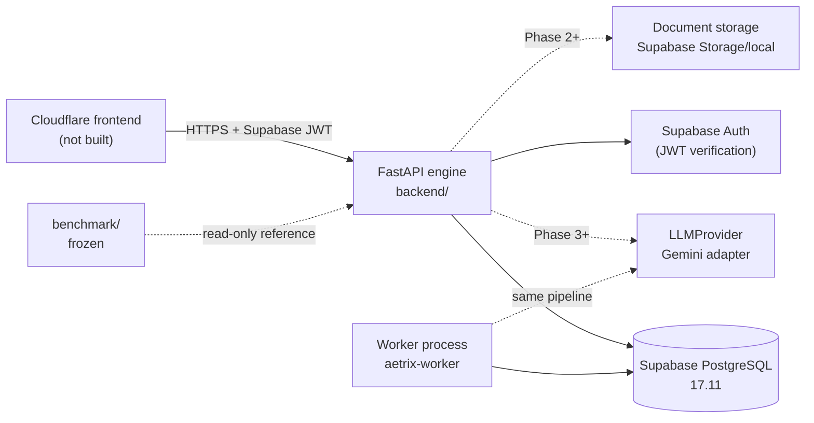

# Initial Repository Audit — Aetrix V5.5

**Date:** 2026-11-05
**Scope:** `C:\Projects\Engine_V5.5`, `C:\Projects\MATH_CHECKER_V5`, `C:\Projects\UI_Webpage_V5.5`
**Method:** read-only inventory, test discovery, import/call-site tracing and live database verification. No file in V5 or the UI repository was modified.
**Status:** Phase 0 complete. This document records the evidence that shaped Phase 1.

---

## 1. Executive summary

1. **`Engine_V5.5` is not the V5 engine.** It is a benchmark and holdout harness: roughly 6,191 LOC of benchmark code, 3,696 LOC of holdout code, 207 collected tests, one real marked paper, and no backend, API, database or marking service.
2. **The real engine is `MATH_CHECKER_V5`.** It contains roughly 123,428 LOC of Python across 153 application modules and 135 test files (2,413 tests), with FastAPI, React, SQLite, Google Classroom integration and multi-key Gemini access.
3. **The destination UI repository contains no application code.** `UI_Webpage_V5.5` is 60 planning and audit documents. Its blueprint assumes Cloudflare Workers, D1, R2, Queues and Better Auth, and it still lists 16 owner decisions as open.
4. **The brief's central premise is partly stale.** The in-process correction path in V5 does omit the blueprint, but the worker path passes and applies one. The deeper defect is not "the blueprint is never passed"; it is that V5's blueprint is best-effort, cached by file hash outside the database, may silently fall back to `None`, and has no teacher approval, versioning or audit trail.
5. **V5.5's actual improvement is therefore:** the blueprint becomes a canonical, teacher-approved, immutable, database-backed version that gates marking. Passing a file path to a prompt is not the innovation.
6. **The benchmark cannot certify a marking strategy yet.** The single real fixture has a reference of 76/87 with a 74-78 band. The ten-paper holdout is blocked at zero certified papers. The measured A/B/C strategies all disagree with at least one criterion; none is strictly correct.

---

## 2. Repository inventory

| Program | Path | What it is | Scale | Runtime | Tests | Disposition |
|---|---|---|---|---:|---|---|
| Aetrix V5.5 harness | `Engine_V5.5` | Benchmark, holdout, frozen scoring, one fixture | ~9,887 LOC + 207 tests | Python 3.13, SymPy | 207 | **Frozen reference.** No production imports; no edits to frozen digests. |
| MATH_CHECKER_V5 | `MATH_CHECKER_V5` | Full marking product | ~123,428 LOC Python, 153 app modules | FastAPI + React + SQLite + Gemini | 135 files / 2,413 tests | **Reference only.** Port concepts behind new interfaces; do not import wholesale. |
| UI Webpage V5.5 | `UI_Webpage_V5.5` | Planning and audit documents | 60 documents, zero code | None | None | **Conflict, not code.** Recorded in ADR-001; frontend withheld. |
| Aetrix V5.5 engine | `Engine_V5.5/backend` | New Python engine, Phase 1 | See §7 | FastAPI + PostgreSQL 17 | 48 new tests | **This build.** |

### 2.1 `Engine_V5.5` contents

- `benchmark/code/`: provider adapter, execution/retry ledger, key pool, schema validation, SymPy verifier, criterion evaluator, configuration and pricing.
- `benchmark/tests/`: unit and harness tests.
- `benchmark/holdout/`: holdout manifest, scoring rules and certification gate.
- `benchmark/final_tests/ch2-l3-final-01/`: the one real paper, scripts, reports and `reference/GROUND_TRUTH.json`.
- `benchmark/ground_truth/paper-01.json`: the older 80/87 candidate reference.
- No `backend/`, no HTTP service, no database, no worker.

### 2.2 `MATH_CHECKER_V5` contents

- `backend/app/engine/`: `service.py` (in-process correction), `legacy_marking.py` (1,163 LOC preserved marking engine and prompts), `blueprint.py` (1,925 LOC best-effort extraction/cache), `scheme_structure.py` (sub-question identity), verification and worker orchestration.
- `backend/app/workers/child.py`: worker path that loads the blueprint, filters exclusions, passes it to marking and applies it.
- `backend/app/automation/grading.py`: automation path with no blueprint at all.
- `backend/app/gemini/key_manager.py`: key fingerprinting, rotation and cooldown.
- `backend/app/db.py` + `schema.sql`: SQLite persistence. Not reusable as the V5.5 store.
- `backend/app/`: FastAPI application, Google Classroom integration, React build.
- Security finding: root-level `API_KEYS.txt` and `client_secret_*.json` files are untracked and git-ignored, but they exist in plaintext on disk. Their contents were not copied, printed or committed during this audit.

### 2.3 `UI_Webpage_V5.5` contents

- 60 Markdown documents: product brief, architecture, marking policy, data model, UI flows, risk register, open questions.
- No `package.json`, no Worker source, no frontend source.
- The architecture specifies Cloudflare Workers + D1 + R2 + Queues + Better Auth.
- The documents say V5 remains the source of truth until marking parity is proven.
- `docs/decisions/OPEN_QUESTIONS.md` records 16 owner decisions with defaults; none were resolved by this build.

---

## 3. The corrected premise: how V5 actually handles the blueprint

The brief's claim that V5 never passes the blueprint is only true for one path.

| Path | Loads blueprint? | Passes/applies it? | Evidence |
|---|---|---|---|
| In-process `CorrectionService.handle_job` | No | No | `backend/app/engine/service.py` call site has no blueprint argument. |
| Worker `workers/child.py` | Yes | Yes — filters exclusions, passes `blueprint=blueprint`, calls `apply_blueprint` | Worker child call site. |
| Automation `automation/grading.py` | No | No | No blueprint reference. |

The more important defects are shared by every path:

1. **Best-effort extraction.** A blueprint is inferred when possible; failure is tolerated.
2. **File-hash cache outside the database.** The cache key is a file SHA, not a versioned entity. A changed file produces a different cache key; a deleted cache loses provenance.
3. **Silent `None` fallback.** Marking can proceed with no blueprint, so the paper's structure is not a hard precondition.
4. **No approval.** No teacher signs off on the structure that gates marking.
5. **No versioning.** There is no immutable version chain and no "approved version" pointer.
6. **No audit.** No record of who approved what, when, or why.
7. **No database constraint.** Nothing prevents an assignment from pointing at an unapproved or missing blueprint.

**V5.5 decision:** the blueprint is a first-class, tenant-owned, versioned entity. Drafts are immutable once approved; approval promotes only the exact stored draft; an assignment can reference only an approved blueprint; the job stores the exact blueprint version id and content hash; superseded versions remain readable for provenance. This is ADR-004.

---

## 4. Reuse and deprecation matrix

| Capability | V5 / harness source | V5.5 treatment | Reason |
|---|---|---|---|
| Marking rules, ECF/ISW/alternative-method semantics | `legacy_marking.py`, benchmark policy docs | **Port behind new interfaces with tests** | Domain knowledge is valuable; the implementation is coupled to V5. |
| Blueprint/scheme-structure concepts | `blueprint.py`, `scheme_structure.py` | **Port concepts, replace persistence and lifecycle** | V5 is best-effort and file-keyed; V5.5 requires approval and versioning. |
| Failure classification and retry/quota state machine | `execution.py`, `keypool.py`, `docs/API_QUOTA_AND_RETRY.md` | **Port the state machine; keep provider-neutral** | 13 failure classes and a per-correction budget are reusable. |
| SymPy equivalence (`equivalent`/`unknown`) | `verifier.py` | **Port with its conservatism intact** | `unknown` must never become `different` by accident. |
| Criterion precision/recall/F1 and false awards | `evaluator.py` | **Keep in benchmark; mirror metrics in evaluation** | The scoring rules are frozen. |
| Determinism lessons | `MARKING_DETERMINISM_INVESTIGATION.md` | **Encode as tests and invariants** | Missing-question placeholders were a real defect. |
| SQLite persistence | `db.py`, `schema.sql` | **Deprecate** | No SQLite production path; SQLAlchemy/PostgreSQL required. |
| Global configuration | `config.py` | **Deprecate** | Typed, environment-validated settings instead. |
| Google SDK coupling | provider modules | **Deprecate** | `LLMProvider` protocol + real adapter later. |
| Path-keyed caches | `blueprint.py` | **Deprecate** | Database-backed versions with content hashes. |
| Frontend / D1 / Better Auth plan | UI docs | **Defer; reconcile in ADR-001** | Conflicts with the approved target architecture. |
| Benchmark scoring and frozen digests | `benchmark/` | **Freeze** | Pre-registered measurement must not move. |

---

## 5. The three-program conflict

There are three different architectural intentions in the workspace:

1. **`MATH_CHECKER_V5`** — a working product with SQLite, FastAPI, React, Google Classroom and Gemini.
2. **`UI_Webpage_V5.5`** — a Cloudflare-native plan: Workers, D1, R2, Queues, Better Auth.
3. **The approved V5.5 brief** — a Python engine with Oracle-portable application code, Supabase PostgreSQL/Auth/Storage and a Cloudflare frontend.

The brief governs this build. ADR-001 records the conflict and the reconciliation requirement. No frontend code was copied, and no D1/Better Auth code was written.

**Dependency rules enforced in Phase 1:**

- Production code in `backend/app` never imports from `benchmark/`.
- The API and worker share the database but not a process; an API restart cannot interrupt a correction.
- No SQLite engine is accepted by configuration.
- Provider access is behind a protocol; Phase 1 ships an *unavailable* pipeline rather than a fake one.
- Prompts will be versioned assets, not embedded strings (Phase 5).

---

## 6. Golden data and measurement

### 6.1 The one real paper

`benchmark/final_tests/ch2-l3-final-01`:

- 38 scoreable items, 87 marks.
- Reference: **76/87**, band **74-78**.
- Q12: `source_mismatch` — the student page repeats Q11 while the scheme's Q12 is different.
- Q16d: `not_printed`.
- Q30/Q31/Q34: the scheme says "Working required"; the policy affects whether method marks can be awarded.
- These are fixture-scoped exceptions. They must never become global engine rules.

The older `benchmark/ground_truth/paper-01.json` reference is 80/87. It is a candidate, not a second certified paper.

### 6.2 Measured strategies

| Strategy | Score | Reference used | Criterion F1 | Strictly correct? |
|---|---:|---:|---:|---|
| A | 77 | 72 | 0.9479 | No |
| B | 74 | 74 | 0.9610 | No strategy is strictly correct |
| C | 78 | 82 | 0.9875 | No |

The holdout manifest reports `blocked_no_certified_papers` with zero certified papers. No generalisation claim is possible from one paper.

---

## 7. What Phase 1 actually built

| Area | Delivered | Evidence |
|---|---|---|
| Configuration | Typed `pydantic-settings`; dev/test/prod; production refuses dev auth, SQLite, default encryption key and wildcard CORS | `backend/app/core/config.py`; unit tests |
| Logging | JSON logs, request/tenant/job context, redaction of bearer tokens, Google keys, JWTs, long hex | `core/logging.py` |
| Errors | Closed error vocabulary; safe handlers; no internal exception text returned | `core/errors.py` |
| Database | SQLAlchemy 2.0 models for 25 domain tables; Alembic migration; 55 foreign keys | Supabase `alembic_version = 0001_append_only` |
| Jobs | 13 states, guarded transitions, optimistic `record_version`, idempotency, leases, heartbeats, crash reclaim, cancellation, retry | `jobs/states.py`, `db/repositories.py`, `jobs/service.py`, `jobs/runner.py` |
| Auth/tenancy | Supabase JWT via JWKS or HS256; tenant claim or user lookup; repository-level tenant scoping; cross-tenant 404 tests | `api/deps.py`, tests |
| API | Health/ready/version, exams, blueprint draft/approval, assignments, submissions, corrections create/get/list/cancel/retry, usage, provider health | `api/` |
| Pipeline boundary | `CorrectionPipeline` protocol; Phase 1 `UnavailablePipeline` parks with `PIPELINE_UNAVAILABLE`; no fake marks | `jobs/pipeline.py`, test |
| Audit | Append-only audit events, job events and provider usage; database triggers reject updates | Migration `0001_append_only` |
| Tests | 48 new tests: unit, PostgreSQL integration, API; all passing | `backend/tests` |

Database facts: PostgreSQL **17.11** on Supabase (the plan said 15; 17 is the provider's current engine), 26 public tables including `alembic_version`, 55 foreign keys, three append-only triggers.

---

## 8. Risk register

| ID | Risk | Likelihood | Impact | Mitigation / status |
|---|---|---|---|---|
| R1 | Marking accuracy is unproven; one paper, two references | High | High | No generalisation claim. Keep fixture exceptions scoped. Phases 5-8 and CP6 evaluate. |
| R2 | Provider quota/key failure | High | Medium | Key-pool state machine in Phase 9; unavailable pipeline parks rather than simulates. |
| R3 | Prompt injection from student pages or scheme text | Medium | High | Treat model output as untrusted; deterministic validation; evidence-bound marks. Phase 6. |
| R4 | Cross-tenant data leakage | Low | Critical | Tenant id on every row; repository filters; cross-tenant 404 tests; no RLS reliance. |
| R5 | Double-marking after a crash | Medium | High | Lease + attempt budget + idempotent creation. Pipeline checkpoints required in Phase 5. |
| R6 | Blueprint drift between draft and marking | Medium | High | Immutable approved versions; content hash bound to the job; approval of exact draft only. |
| R7 | Database credentials exposed | Medium | High | Untracked `.env`; no secret in git/logs; rotate before sharing. Production secret store is a deployment task. |
| R8 | V5 reference drifts from V5.5 | Medium | Medium | V5 is read-only reference; no imports; decisions recorded here. |
| R9 | Oracle portability breaks on PostgreSQL-specific SQL | Medium | Medium | SQLAlchemy 2.0; only the lease query uses `FOR UPDATE SKIP LOCKED` (also supported by Oracle). JSON/migrations need an Oracle pass. |
| R10 | UI D1/Better Auth plan is built by mistake | Medium | High | ADR-001; frontend withheld until reconciled. |
| R11 | Worker dies mid-job | Medium | High | Heartbeat, lease expiry, reclaim, attempt cap; test covers reclaim. |
| R12 | Hosted migration partially applies | Low | High | Single transactional Alembic upgrade; verified head. Rollback requires a reviewed downgrade. |
| R13 | API cost overrun | Medium | Medium | Per-correction budget, quota policy, usage ledger; not yet enforced by a live provider. |
| R14 | Benchmark overfitting | High | High | Frozen digests, holdout gate, no production imports. |
| R15 | Observability gaps | Medium | Medium | Structured logs and audit; metrics/tracing are Phase 16. |

---

## 9. Security findings

### 9.1 Confirmed findings

1. **V5 plaintext credentials on disk.** `MATH_CHECKER_V5/API_KEYS.txt` and `client_secret_*.json` are git-ignored but present in plaintext. This is an operational risk: disk snapshots, backups and screen sharing expose them. Recommendation: move to a secret manager, restrict ACLs, rotate the keys, and never copy them into another repository. No contents were copied or logged here.
2. **Development database credential.** The Supabase password is stored only in untracked `backend/.env`. It must be rotated before the environment is shared, and production must use a secret store.
3. **No RLS reliance.** The engine connects directly to PostgreSQL, so Supabase row-level security would not protect these queries. Isolation is enforced in repositories and tests. This is acceptable for Phase 1 but must remain a reviewed invariant.
4. **Append-only evidence.** `audit_events`, `job_events` and `provider_usage` reject `UPDATE` at the database level. Deletion remains possible for retention/tenant removal; this is a deliberate distinction, not an oversight.

### 9.2 Controls present in Phase 1

- Production refuses development authentication, SQLite, the development encryption key and wildcard CORS.
- JWT verification requires `exp` and `sub`; JWKS restricts algorithms to RS256/ES256, HS256 only for the legacy secret.
- Provider credentials are encrypted with Fernet (schema and service; no live credential is stored yet).
- Logs redact bearer tokens, Google-style keys, JWTs, long hex strings and sensitive keys.
- API errors do not return database exception text.
- Cross-tenant reads return 404, not 403, so existence is not leaked.
- Idempotency keys are tenant-scoped and bound to a request hash; reuse with different content is a conflict.

### 9.3 Gaps deferred to later phases

- Upload validation, malware scanning and MIME sniffing (Phase 13).
- Rate limiting and abuse controls (Phase 13).
- Key rotation UI and per-tenant provider credentials (Phase 9).
- Prompt-injection defenses and model-output validation (Phase 6).
- Metrics, tracing and alerting (Phase 16).
- Penetration test and tenancy suite (Phase 13).
- Live Gemini verification (Phase 9; not exercised in Phase 1 because no adapter exists).

---

## 10. Environment audit

| Item | Value |
|---|---|
| OS | Windows, Git Bash |
| Project interpreter | `.tools/python/python.exe` 3.13.7 (no `venv` module) |
| Engine venv | `backend/.venv` created with `virtualenv` |
| FastAPI | 0.162.0 |
| SQLAlchemy | 2.0.57 |
| Alembic | 1.20.1 |
| psycopg | 3.3.8 |
| Pydantic | 2.14.3 |
| pytest | 8.4.2 |
| PostgreSQL | Supabase 17.11, `eu-west-2` |
| Connection | `aws-0-eu-west-2.pooler.supabase.com:5432` (session pooler) |
| Direct host | `db.<ref>.supabase.co` did not resolve from this network; Supabase direct connections are IPv6-only for this project, so the session pooler was used |
| Docker | Not installed; not used |
| Benchmark tests | 207 passed |
| Frozen digests | Valid; holdout blocked at zero certified papers |
| New engine tests | 48 passed |

The direct database host is not reachable from this machine because it has no IPv4 record and the network did not provide usable IPv6. The session pooler is the supported path. Transaction-mode port 6543 also connected, but session mode is used for DDL and long-lived worker sessions.

---

## 11. Acceptance evidence for Phase 1

| Gate | Evidence | Result |
|---|---|---|
| `alembic upgrade head` on Supabase Postgres | `alembic_version = 0001_append_only`; 26 tables | Pass |
| API boots | `create_app` import and TestClient `/health` | Pass |
| Job survives worker kill and is reclaimed without double-marking | Lease-expiry reclaim test; attempts increment; no question results | Pass |
| Duplicate POST returns the same job | API test: 201 then 200, same id | Pass |
| Cancel is terminal | Cancel test: `CANCELLED`; retry returns 409 | Pass |
| Cross-tenant reads 404 | API and service tests | Pass |
| All new tests pass | 48 passed | Pass |
| Benchmark frozen digests still validate | `python -m benchmark.holdout.manifest --check-code` → `valid: true` | Pass |
| Benchmark/holdout suites unchanged | 207 passed | Pass |

---

## 12. Non-claims

- No production-readiness claim. Phase 1 is infrastructure, not a marking engine.
- No generalisation from one paper.
- No "20-fixture parity" claim; the holdout has zero certified papers.
- No frontend implementation.
- No live Gemini success claim. The provider adapter and bounded smoke run belong to the provider phase; Phase 1 neither simulated nor claimed a live result.
- No claim that the A/B/C strategies are correct.
- No claim that Oracle portability is tested; only that the code avoids a SQLite path and isolates PostgreSQL-specific SQL.
